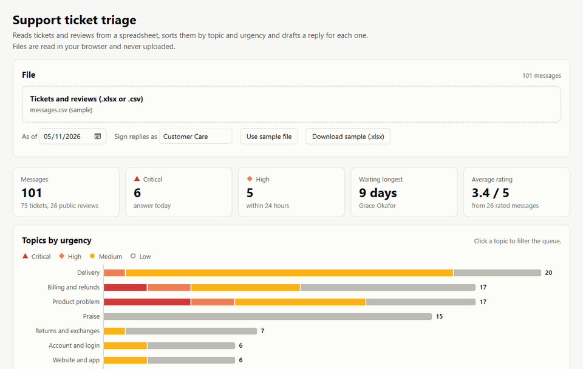

# TicketSort

Support ticket triage. Reads customer tickets and reviews from a spreadsheet, sorts them by topic and urgency and drafts a reply for
each one, so the safety report and the third refund request get answered before the thank-you notes.



Open `site/index.html` in a browser. It starts with the sample file; drop your own `.xlsx` or `.csv` to
replace it. Everything runs in the page, so nothing is uploaded anywhere.

## Input

One row per message. Only `message` is required.

| Column | Also accepted as |
| --- | --- |
| `id` | `ticket`, `number`, `ref` |
| `date` | `created`, `received`, `opened` |
| `channel` | `source`, `via`. Values with *review*, *store*, *app store*, *google* and the like count as public |
| `customer` | `name`, `from`, `requester` |
| `rating` | `stars`, `score` (1 to 5) |
| `subject` | `title`, `summary` |
| `message` | `body`, `text`, `review`, `description`, `comment` |

The `.xlsx` reader takes the first sheet and handles Excel date cells. Dates in text as `2026-11-05` or
`05/11/2026`.

## Topics

Billing and refunds, delivery, product problem, returns, account and login, website and app, cancellation,
praise, suggestion, other. The topic with the most keyword hits wins, and words in the subject count double.
Praise needs a message with no complaint in it. A message that does not say what it is about ("following
up", "any news?") takes the topic of the same customer's earlier message.

## Urgency

| Signal | Points |
| --- | --- |
| Safety words: smoke, sparks, burn, shock, injury | always critical |
| Threat to escalate: chargeback, lawyer, consumer protection | 40 |
| Money taken in error: charged twice, unauthorized | 30 |
| 1-star / 2-star rating | 20 / 10 |
| Public review rated 1 or 2 | 10 |
| Repeat contact in the text (still, again, no reply) | 15 |
| Same customer wrote before | 15 |
| Waiting over 2 / over 5 days | 10 / 20 |
| Asks for urgency, time-sensitive, angry tone | 10 each |
| Topic base: cancellation, product problem, delivery, billing, account | 15, 10, 5, 5, 5 |

Critical from 70, high from 40, medium from 15. The queue is sorted by level, then score, then waiting time.

## Replies

Each draft uses the customer's first name, the order number when there is one, a paragraph for the topic and
a response time that matches the level. Public reviews get a short public answer that moves the details to a
private channel. Drafts can be edited on the page before copying, and the edited text goes into the CSV
export.

## Development

```bash
npm test          # node --test, no dependencies
npm run sample    # rebuild site/sample-data.js after editing data/messages.*
```

`site/triage.js` holds all the logic and loads both in the browser and in Node.

Sample customers, orders and messages are invented.

## License

MIT
